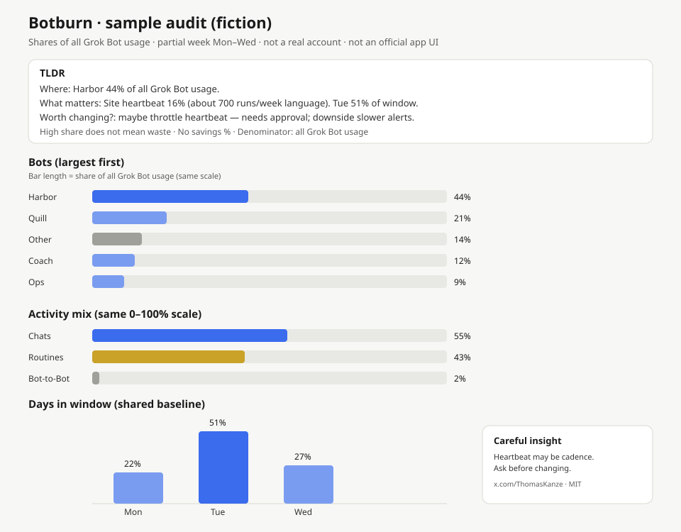

# Botburn

**Find where your Grok bots burn usage — across every task, not just coding.**

Created by [Thomas Kanze](https://x.com/ThomasKanze) · MIT © 2026 · **v0.1.0 early release**

Source: [github.com/apwn/botburn](https://github.com/apwn/botburn)

> Not affiliated with xAI, Grok, or Cursor.

---

## TLDR

Your Grok Bot fleet does more than write code. Chats, routines, coaching,
ops pulses, drafts, shipping check-ins, bot-to-bot — they all hit the same
usage report. Botburn reads that report and answers three things, visually
when you ask for a dashboard:

1. **Where usage went** — biggest bots and routines (reported shares of
   **all Grok Bot usage** in the window).
2. **What matters** — the spike or frequent check worth noticing.
3. **What's worth changing** — up to three evidence-backed tradeoffs — or
   **no justified change**. High use ≠ waste.

Short TLDR on top; largest-first charts next; source tables and provenance
below. Needs a **Grok Bot** with the usage report. Ordinary Cursor reading
this file does **not** give Cursor Grok Bot usage access.

**v0.1.0** is an early public kit (skill + docs + synthetic sample). Not a
GitHub Release until review. Not an official product. Limitations below are
real.

---

## Visual example (synthetic)



*Fiction only. Shares of all Grok Bot usage in a sample Mon–Wed window. Harbor 44% = chats 28% + routines 16%. Days 22% + 51% + 27% = 100%. No token counts. Not an official app UI. Raster twin: [docs/assets/botburn-sample-audit.png](docs/assets/botburn-sample-audit.png).*

---

## Install

1. Attach [`SKILL.md`](./SKILL.md) in a chat with your **Grok Bot**.
2. Ask it to **save this as a reusable skill named Botburn**.
3. Invoke with `@Botburn`.

```text
@Botburn — where did usage go? TLDR first.
@Botburn show a visual dashboard
```

That is the install. No app to deploy. This repo is the skill + docs.

---

## What you get (all tasks)

Botburn is not a coding profiler. It uses the supported usage report only
and tells you, in plain language:

- Which bots burned the window (whatever you actually run — chats, coach
  check-ins, ops, drafts, shipping, social, not “the coding bot”).
- How much was chats vs routines vs bot-to-bot.
- Which day spiked, using that window’s denominator.
- Whether anything is worth changing — or that it isn’t.

It will not invent tokens, per-call costs, dollar savings, or a coding %.
If the report cannot attribute a slice, Botburn says so.

---

## Deep dive

Start with the TLDR. When you want more:

```text
@Botburn deep-dive the largest bot — activity mix, full routines, busiest days
```

Botburn adds slices only as needed (it will not explode every
cross-product):

1. Fleet **bot × activity**
2. High list limit for full routines on the biggest bots
3. Largest bot(s) **× day** (optional activity × day)
4. At most two small transcript peeks if a name is opaque

Ask for a **visual dashboard** / Page / canvas when you want charts.
Botburn loads **managed canvas** after **managed usage-review**
(usage-review wins on report conflicts), then: TLDR → largest-first
charts → embedded drilldowns **only for slices it actually fetched** →
source details below.

---

## Quick text example (same fictional fleet)

| | |
| --- | --- |
| **Where** | Harbor **44%** |
| **What matters** | Site heartbeat **16%** (about 700 runs/week language) · Tue **51%** of window |
| **Worth changing?** | Maybe throttle heartbeat — approval; downside slower alerts; medium confidence |

Full write-up: [`examples/sample-audit.md`](./examples/sample-audit.md) ·
layout notes: [`examples/sample-dashboard-notes.md`](./examples/sample-dashboard-notes.md)

---

## Reporting limitations (read these)

- **Reported shares only.** No invented tokens, models, per-call costs,
  forecasts, or savings %.
- **Global denominator.** Figures are shares of **all Grok Bot usage** in
  the window unless the report says it renormalized.
- **`<1%` stays `<1%`.** Not charted as 0, 0.5, or 1 — tables only.
- **Frequency language ≠ executions.** “About N runs a week” is report
  wording, not a counted run total.
- **Labels ≠ tasks.** “Chats” / “not from a routine” / a bot name do not
  prove what was done. No coding % unless the report states one.
- **High share ≠ waste.** At most three suggestions, only if valuable;
  else **no justified change**. Changes need your approval.
- **Plan shape from the report.** Weekly limit, Enterprise team usage, or
  trial — do not force the wrong template.
- **Cannot attribute:** coding %, exact chat tasks, tokens, Cloud Agents
  ([Cursor usage dashboard](https://cursor.com/dashboard?tab=usage)), other
  apps on a shared limit.
- **This kit was not run against all accounts.** Examples are synthetic.
  Live reads happen only in *your* Grok Bot, via the usage report.
- **Page sharing is user-controlled.**

---

## Package

| | |
| --- | --- |
| Skill | [`SKILL.md`](./SKILL.md) |
| Method | [`docs/methodology.md`](./docs/methodology.md) |
| Draft notes | [`docs/RELEASE-NOTES.md`](./docs/RELEASE-NOTES.md) |
| License | [`LICENSE`](./LICENSE) (MIT) |
| Local QA | `python3 scripts/validate.py` |

**Botburn** — *find where your bots burn* · [Thomas Kanze on X](https://x.com/ThomasKanze)
